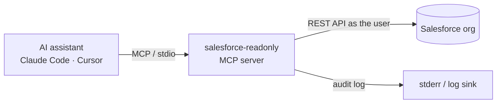

# Salesforce MCP Starter (Read-Only)

> A minimal, **least-privilege Model Context Protocol (MCP) server** that lets AI assistants
> (Claude Code, Cursor, VS Code Copilot) safely inspect a Salesforce org — schema, records and SOQL —
> without any write access.


---

## What is MCP?

The **Model Context Protocol** is an open standard — think *"USB-C for AI tools"*. An MCP **server**
exposes typed tools; any MCP **client** (an AI assistant) can discover and call them. Instead of
pasting org data into a chat, the assistant queries the org directly, under the user's own permissions.



## Tools

| Tool | Description |
|---|---|
| `whoami` | Connected user and org |
| `describe_object` | Fields, types, required flags, active picklist values, relationships |
| `run_soql` | SELECT-only SOQL, row cap enforced (default 200) |
| `get_record` | One record by Id with chosen fields |

## Safety model

- **Read-only** — no DML, Apex execution or metadata deploys are exposed.
- **Runs as the user** — Salesforce sharing, CRUD and FLS still apply.
- **Input validation** — Zod schemas validate object names, Ids and field lists.
- **SOQL guard** — rejects non-SELECT statements and DML keywords; adds/caps `LIMIT`.
- **Audit trail** — every tool call is logged as structured JSON.
- **No stored secrets** — reuses the Salesforce CLI session (`sf org display`).

## Setup

```bash
npm install && npm run build && npm test
sf org login web --alias my-sandbox
```

Add to your MCP client config (e.g. `.mcp.json` / Cursor `mcp.json`):

```json
{
  "mcpServers": {
    "salesforce-readonly": {
      "command": "node",
      "args": ["/absolute/path/salesforce-mcp-starter/dist/index.js"],
      "env": { "SF_TARGET_ORG": "my-sandbox" }
    }
  }
}
```

Then ask your assistant: *"Describe the Case object and show me the 5 newest escalated cases."*

## Extending it

Ideas for a production diagnostic server: metadata read tools (flows, validation rules, permission
sets), per-user/per-tool allow-lists, OAuth for hosted (HTTP/SSE) deployment, and shipping audit logs
to a SIEM.

## License

MIT © Naman G Shetty
